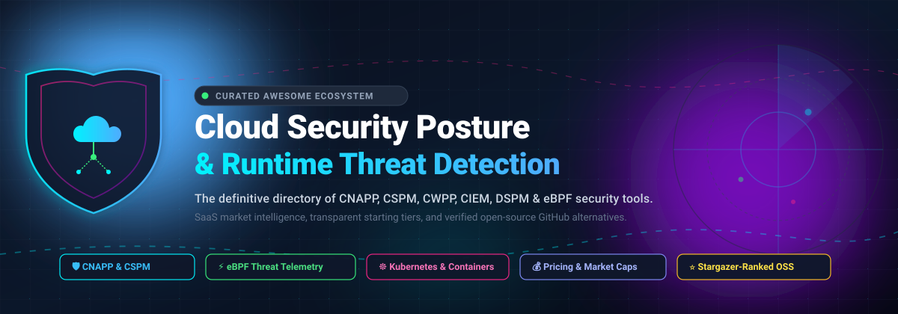

<div align="center">

<p align="center">
  
</p>

# 🛡️ Awesome Cloud Security Posture & Threat Detection

<p align="center">
  <strong>A curated index of enterprise CNAPP/CSPM platforms, runtime threat detection suites, and open-source cloud security tooling.</strong>
</p>

<p align="center">
<a href="https://github.com/ishandutta2007/Awesome-Awesome-Awesome"></a><a href="https://discord.gg/jc4xtF58Ve"></a>
<a href="https://github.com/ishandutta2007/Awesome-Cloud-Security-Posture-Threat-Detection/stargazers"></a>
<a href="https://github.com/ishandutta2007/Awesome-Cloud-Security-Posture-Threat-Detection/network/members"></a>
<a href="https://github.com/ishandutta2007/Awesome-Cloud-Security-Posture-Threat-Detection/issues"></a>
<a href="https://github.com/ishandutta2007/Awesome-Cloud-Security-Posture-Threat-Detection/blob/main/LICENSE"></a>
<a href="https://github.com/ishandutta2007"></a>
</p>

<p align="center">
  <a href="#-sector-overview--market-dynamics">Sector Overview</a> •
  <a href="#-saashosted-platforms">SaaS Platforms</a> •
  <a href="#-open-source-github-projects">Open-Source Projects</a> •
  <a href="#-how-to-contribute">Contribute</a> •
  <a href="#-star-history">Star History</a> •
  <a href="#-support--sponsorship">Support</a>
</p>

---

</div>

## 📖 Introduction & Scope

Welcome to **Awesome Cloud Security Posture & Threat Detection**! This repository serves as a comprehensive, SEO-optimized, industry-standard reference manual for cloud security architects, DevSecOps practitioners, SOC analysts, and engineering leaders navigating the multi-cloud security ecosystem.

As organizations scale their workloads across **Amazon Web Services (AWS)**, **Microsoft Azure**, and **Google Cloud Platform (GCP)**, managing security risk across distributed cloud environments requires two critical capabilities:
1. **Cloud Security Posture Management (CSPM) & CNAPP**: Continuously discovering cloud resources, identifying misconfigurations, enforcing least-privilege identity access management (CIEM/IAM), protecting data (DSPM), and adhering to compliance benchmarks (CIS Benchmarks, PCI-DSS, SOC 2, HIPAA, ISO 27001).
2. **Runtime Cloud Threat Detection & CWPP**: Leveraging Linux kernel eBPF probes, syscall analytics, container runtime sensors, and behavioral anomaly machine learning to intercept zero-day attacks, privilege escalation, lateral movement, and cloud crypto-jacking in real time.

This guide benchmarks market-leading **commercial SaaS platforms** (ranked by company size and valuation, with verifiable starting tiers and trial rules) alongside **high-performing open-source GitHub alternatives** (ranked by stargazer popularity).

---

## 📑 Table of Contents
- [📊 Sector Overview & Market Dynamics](#-sector-overview--market-dynamics)
- [☁️ SaaS/Hosted Platforms](#️-saashosted-platforms)
- [💻 Open-Source GitHub Projects](#-open-source-github-projects)
- [🤝 How to Contribute](#-how-to-contribute)
- [⭐ Star History](#-star-history)
- [💖 Support & Sponsorship](#-support--sponsorship)
- [⚖️ Disclaimer](#️-disclaimer)

---

## 📊 Sector Overview & Market Dynamics

The global **Cloud-Native Application Protection Platform (CNAPP)** and **Cloud Security Posture Management (CSPM)** sector represents one of the fastest-growing arenas in enterprise infrastructure cybersecurity:

* **Market Valuation & Growth**: Valued globally at **$10.5B to $13.8B in 2025**, the CNAPP market is projected to expand to **$12.6B to $17.8B in 2026** (reflecting a robust compound annual growth rate of **~19% to 22.5%**), on a trajectory exceeding **$50B+** by the early 2030s.
* **Fragmentation vs. Consolidation Dynamic**: Historically, the cloud security landscape was **heavily fragmented** across isolated point solutions—separate tools for posture management (CSPM), workload defense (CWPP), identity governance (CIEM), and infrastructure-as-code (IaC) linting. However, enterprises are now violently consolidating tools to eradicate alert fatigue and vendor sprawl. The market has rapidly crystallized into a **concentrated, winner-take-most platform oligopoly**, where dominant cloud-native platforms (e.g., Wiz, Palo Alto Networks Prisma Cloud, CrowdStrike Falcon, and Datadog) capture the overwhelming majority of large enterprise multi-cloud security investments.

---

## ☁️ SaaS/Hosted Platforms

The following enterprise platforms offer managed multi-cloud posture, threat intelligence, and compliance automation. Sorted in **descending order by company scale** (market capitalization, valuation, and annual revenue).

| Product | 🏢 Company Size (Valuation / Market Cap / Revenue) | 💵 Pricing (Starting Tier) | ⏳ Free Tier Limits / Free Trial | 📝 Description |
|:---|:---|:---|:---|:---|
| **[Palo Alto Prisma Cloud](https://www.paloaltonetworks.com/prisma/cloud)** | ~$280B–$320B Market Cap (FY26 rev ~$11.5B) | Starts at ~$18,000/yr (baseline 100 Prisma Cloud Credits at ~$180/credit/yr for CSPM) | 30-day free trial (full evaluation access across multi-cloud environments via sales/marketplace) | Comprehensive enterprise CNAPP suite covering CSPM, CWPP, CIEM, DSPM, and WAAS credit allocations. |
| **[CrowdStrike Falcon Cloud Security](https://www.crowdstrike.com/)** | ~$220B–$260B Market Cap (FY26 rev ~$4.8B) | Starts at $0.25/resource/month ($3/resource/yr) for CSPM; $180/workload/yr for Cloud Workload Protection | 15-day free trial (plus a 30-day interactive virtual Falcon Test Drive environment) | Unified cloud workload protection extending Falcon EDR sensors to cloud compute, containers, and posture audits. |
| **[Fortinet (FortiCNAPP / Lacework)](https://www.lacework.com/)** | ~$90B–$105B Market Cap (Acquired Lacework for $152.3M) | Starts at ~$15,000/yr (entry standalone tier for up to 100 workloads) | 14-day free trial (full feature access for cloud accounts and container workload analysis) | Behavioral ML-driven CNAPP utilizing the Polygraph anomaly engine, integrated into Fortinet Security Fabric. |
| **[Datadog Cloud Security](https://www.datadoghq.com/)** | ~$65B–$75B Market Cap (FY26 rev ~$4.2B TTM) | Starts at $120/host/year ($10/host/month) for Cloud Security Management (CSM Pro); $180/host/year for Cloud Workload Security (CWS) | 14-day free trial (includes full access to host security, posture management, and compliance checks) | Cloud Security Management and runtime detection natively integrated into Datadog's unified observability stack. |
| **[Wiz](https://www.wiz.io/)** | $32B Valuation / Acquisition (Google Cloud; >$1B ARR) | Starts at ~$24,000/yr (entry tier for up to 100 workloads; ~$5–$8/workload/month at enterprise scale) | 14-day free trial (full evaluation access; standard enterprise POCs up to 21 days with cloud scanning) | Agentless CNAPP with graph-based correlation, CSPM, CIEM, DSPM, and automated attack-path modeling. |
| **[Zoho Directory](https://www.zoho.com/directory/)** | ~$12.5B Valuation (Bootstrapped, revenue >$1.5B) | Starts at $2.00/user/month (Standard plan, $1.70/user/month billed annually) | Forever Free plan: up to 10 users, 3 third-party cloud apps, 2 directory stores, and 10 devices (45-day free trial for paid tiers) | Workforce IAM and security posture management featuring conditional access, BYOK encryption, and Cloud RADIUS. |
| **[SentinelOne Cloud Workload Security](https://www.sentinelone.com/)** | ~$7.5B–$8.5B Market Cap (FY26 rev ~$1.0B) | Starts at $431.99/year per POD/task (100–500 volume licensing on CDW/AWS Marketplace) | 14-day to 30-day free trial / Proof of Concept (POC) via enterprise sales and authorized partners | Autonomous runtime cloud protection and behavioral threat defense for VMs, Kubernetes clusters, and containers. |
| **[Sysdig Secure](https://sysdig.com/)** | ~$2.5B Valuation (Permira-backed unicorn) | Starts at $72/host/month on AWS Marketplace (with 20-host minimum commitment = $1,440/month) | 30-day free trial (unrestricted access to cloud monitoring, posture compliance, and container runtime security) | Cloud-native security built on eBPF and Falco, providing deep runtime threat detection, CSPM, and K8s compliance. |
| **[Orca Security](https://orca.security/)** | ~$1.8B Valuation (Alphabet/CapitalG backed) | Starts at ~$20,000/yr (entry tier for up to 100 workloads; AWS Marketplace private offers ~$124K/yr) | 30-day free trial / assessment (full SideScanning of AWS, Azure, or GCP accounts with 100% asset discovery) | Agentless cloud security platform using patented SideScanning technology across CNAPP, AppSec, DSPM, and runtime. |
| **[Aqua Security](https://www.aquasec.com/)** | ~$1.0B Valuation (Series E unicorn) | Starts at ~$10,188/year (Team annual tier; Advanced tier starts at ~$25,188/year) | Trivy OSS is 100% free forever; enterprise CNAPP offers customized 14-to-30 day POC trial via sales | Full lifecycle code-to-cloud CNAPP securing software supply chains, cloud posture, and container runtimes. |

---

## 💻 Open-Source GitHub Projects

Curated list of production-grade open-source tools for self-hosted cloud security posture management, Kubernetes vulnerability auditing, IaC security scanning, and kernel-level runtime threat detection.

Sorted in **descending order by GitHub star count**:

| Project | ⭐ Stars | 📄 License | 🛠️ Focus Area | 📝 Description |
|:---|:---|:---:|:---:|:---|
| **[Trivy](https://github.com/aquasecurity/trivy)** | [](https://github.com/aquasecurity/trivy/stargazers) | Apache-2.0 | Vulnerability & Misconfig | All-in-one scanner for container images, Git repositories, Kubernetes clusters, and AWS/cloud infrastructure misconfigurations. |
| **[Prowler](https://github.com/prowler-cloud/prowler)** | [](https://github.com/prowler-cloud/prowler/stargazers) | Apache-2.0 | Multi-Cloud CSPM | Authoritative open-source security tool for AWS, Azure, GCP, and Kubernetes with 500+ checks mapped to CIS, NIST, and PCI-DSS. |
| **[Falco](https://github.com/falcosecurity/falco)** | [](https://github.com/falcosecurity/falco/stargazers) | Apache-2.0 | Runtime Detection | CNCF-graduated runtime security engine using eBPF to monitor Linux system calls and flag abnormal container activity. |
| **[Checkov](https://github.com/bridgecrewio/checkov)** | [](https://github.com/bridgecrewio/checkov/stargazers) | Apache-2.0 | IaC Security | Static code analysis tool scanning Terraform, CloudFormation, Kubernetes manifests, Helm, and ARM templates for cloud vulnerabilities. |
| **[Kube-bench](https://github.com/aquasecurity/kube-bench)** | [](https://github.com/aquasecurity/kube-bench/stargazers) | Apache-2.0 | Kubernetes CIS | Automated Go CLI and Kubernetes Job assessing whether nodes and control planes match the official CIS Kubernetes Benchmark. |
| **[tfsec](https://github.com/aquasecurity/tfsec)** | [](https://github.com/aquasecurity/tfsec/stargazers) | MIT | Terraform Scanning | Fast static security scanner for Terraform code that flags cloud infrastructure weaknesses before deployment. |
| **[Cloud Custodian](https://github.com/cloud-custodian/cloud-custodian)** | [](https://github.com/cloud-custodian/cloud-custodian/stargazers) | Apache-2.0 | Cloud Governance & CSPM | Lightweight YAML rules engine for policy enforcement, real-time remediation, compliance auditing, and cloud cost management. |
| **[ThreatMapper](https://github.com/deepfence/ThreatMapper)** | [](https://github.com/deepfence/ThreatMapper/stargazers) | Apache-2.0 | Open CNAPP | Open-source CNAPP scanning multi-cloud infrastructure for vulnerabilities, secrets, malware, and misconfigurations with visual threat graphs. |
| **[Terrascan](https://github.com/tenable/terrascan)** | [](https://github.com/tenable/terrascan/stargazers) | Apache-2.0 | IaC Policy Engine | Static analyzer leveraging OPA (Open Policy Agent) to detect compliance violations across Terraform, Kubernetes, and Dockerfiles. |
| **[Tetragon](https://github.com/cilium/tetragon)** | [](https://github.com/cilium/tetragon/stargazers) | Apache-2.0 | eBPF Observability | eBPF-based security observability and real-time runtime enforcement tool providing process filtering and kernel-level threat blocking. |
| **[Kube-hunter](https://github.com/aquasecurity/kube-hunter)** | [](https://github.com/aquasecurity/kube-hunter/stargazers) | Apache-2.0 | K8s Pentesting | Active reconnaissance and penetration testing tool hunting for exposed cluster credentials, misconfigured APIs, and attack surfaces. |
| **[Tracee](https://github.com/aquasecurity/tracee)** | [](https://github.com/aquasecurity/tracee/stargazers) | Apache-2.0 | eBPF Threat Tracing | Lightweight runtime security and behavioral detection engine tracking suspicious system activity in Linux environments via eBPF. |
| **[CloudSploit](https://github.com/aquasecurity/cloudsploit)** | [](https://github.com/aquasecurity/cloudsploit/stargazers) | BSD-3-Clause | CSPM Posture Scanner | Automated security posture assessment tool auditing AWS, Microsoft Azure, Google Cloud Platform, and Oracle Cloud environments. |
| **[BotKube](https://github.com/kubeshop/botkube)** | [](https://github.com/kubeshop/botkube/stargazers) | MIT | ChatOps & Event Alerting | Messaging integration monitoring Kubernetes cluster security events, audit anomalies, and resource mutations via Slack, Discord, and Teams. |
| **[PacketStreamer](https://github.com/deepfence/PacketStreamer)** | [](https://github.com/deepfence/PacketStreamer/stargazers) | Apache-2.0 | Network Forensics | High-performance distributed packet capture sensor streaming network telemetry for runtime cloud forensics and threat triage. |
| **[OpenRaven Magpie](https://github.com/openraven/magpie)** | [](https://github.com/openraven/magpie/stargazers) | Apache-2.0 | Asset Discovery | Cloud Security Posture Manager focusing on multi-cloud asset discovery and uncovering unmonitored infrastructure attack surfaces. |

---

## 🏗️ Architectural Blueprint: DIY Open-Source CNAPP

Organizations can build a enterprise-grade, license-free CNAPP pipeline by unifying these modular open-source projects:

```
┌────────────────────────────────────────────────────────────────────────┐
│                   CODE & SUPPLY CHAIN SECURITY                         │
│   • Checkov / tfsec (IaC Security)  • Trivy (SBOM & Dependencies)      │
└───────────────────────────────────┬────────────────────────────────────┘
                                    │ CI/CD Pipeline
┌───────────────────────────────────▼────────────────────────────────────┐
│              CLOUD POSTURE & COMPLIANCE GOVERNANCE (CSPM)              │
│   • Prowler (Multi-cloud audits)    • Cloud Custodian (Automated remediation)│
│   • Kube-bench (CIS K8s Benchmark)  • CloudSploit (Account hardening)  │
└───────────────────────────────────┬────────────────────────────────────┘
                                    │ Runtime Deploy
┌───────────────────────────────────▼────────────────────────────────────┐
│              RUNTIME THREAT DETECTION & TELEMETRY (CWPP)               │
│   • Falco (eBPF syscall detection)  • Tetragon (Kernel enforcement)   │
│   • ThreatMapper (Vulnerability graph) • BotKube (Instant ChatOps)     │
└────────────────────────────────────────────────────────────────────────┘
```

---

## 🤝 How to Contribute

We actively welcome contributions from the cybersecurity community! To suggest a new SaaS platform, open-source project, or update existing metrics:

1. 🍴 **Fork** the repository.
2. 🌿 **Create a new branch**: `git checkout -b feature/add-new-tool`.
3. 📝 **Edit `README.md`**: Ensure entries follow the existing tabular formatting with accurate pricing, company metrics, or stargazers links.
4. 🚀 **Commit your changes**: `git commit -m "Add <Tool Name> to <Section>"`.
5. 📤 **Push to your branch**: `git push origin feature/add-new-tool`.
6. 🔀 **Open a Pull Request** with a brief summary explaining the addition.

---

## ⭐ Star History

[](https://www.star-history.com/#ishandutta2007/Awesome-Cloud-Security-Posture-Threat-Detection&type=date&legend=top-left)

---

## 💖 Support & Sponsorship

If you find this curated directory helpful for your cloud security architecture, research, or team evaluations, please consider supporting the project!

- ⭐ **Star this repository** to help other engineers discover it.
- 🍴 **Fork and share** with your security, DevOps, and cloud teams.
- ☕ **Buy me a coffee / Sponsor the project**: Support ongoing maintenance and open-source research through the **[GitHub Sponsors Dashboard](https://github.com/sponsors/ishandutta2007)**.

Thank you to all contributors, sponsors, and the open-source community for keeping cloud security transparent, collaborative, and accessible! 🙌

---

## ⚖️ Disclaimer

- This curated list is maintained for informational and educational purposes only and does not constitute formal endorsement.
- Cloud security tools interface with administrative cloud APIs and sensitive workload telemetry; always practice least-privilege IAM configuration and verify third-party security policies.
- Commercial pricing figures and valuation data are estimated from publicly available listings, marketplace contracts, and industry benchmarks as of 2025/2026 and are subject to vendor change.

---

<div align="center">

**Built with ❤️ for security engineers, cloud architects, DevSecOps teams, and SOC analysts worldwide.**

</div>
